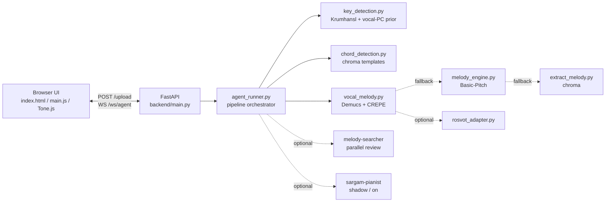

<div align="center">

# सरगम कैफ़े · Sargam Cafe

### AI ear-training & song transcription — upload any song, get a human-like piano performance

[](backend/requirements.txt)
[](package.json)
[](backend/main.py)
[](package.json)
[](main.js)
[](#-license)

*Key detection · vocal-melody extraction · chords · expressive piano rendering — with Indian classical ornaments*

[Features](#-what-it-does) · [Quickstart](#-quickstart) · [Installation](#-installation) · [Usage](#-usage) · [Configuration](#%EF%B8%8F-configuration) · [Architecture](#-architecture) · [Evaluation](#-evaluation)

</div>

---

## 🎹 What it does

| Capability | How |
|---|---|
| **Key / scale detection** | Deterministic Krumhansl-Schmuckler over whole-track HPSS chroma + vocal pitch-class emphasis → Hindustani **thaat** + Western scale (`backend/key_detection.py`) |
| **Vocal melody extraction** | Demucs source separation → torchcrepe pitch tracking → note decoding with octaves, rhythm, velocity/dynamics and ornaments: **meend, gamak, kan-swar, sustain, retrigger** (`backend/vocal_melody.py`) |
| **Chord progression** | Chroma + template matching (major/minor/7th + thaat triads) for left-hand backing (`backend/chord_detection.py`) |
| **Expressive rendering** | Phrase-aware rubato, dynamic arcs, articulation and sustain pedal — the **Human Touch** engine with Faithful / Song-like modes (`main.js`) |
| **Layered playback** | Play **Melody / Chords / With Song** independently, with piano-roll, sargam strip and live note display |
| **Agentic review (optional)** | `piano-master` + parallel `melody-searcher` section reviewers + evidence-gated `sargam-pianist` via the opencode CLI on a free DeepSeek model |

## ✨ Frontend highlights

- Elegant cafe-styled UI (`index.html` + `style.css`, Cinzel + Inter)
- Custom audio player with seek/volume, agent telemetry log streamed over WebSocket
- 4+-octave grand piano (C2–B5 + C6) rendered with the Salamander grand via Tone.js, plus reverb + delay room ambience
- Transcription summary cards: **Sa (Root) · Thaat · Western Scale · Tempo · Transcriber**
- Human Touch sliders: Expression, Rubato, Cadence breath, Pedal, Melody prominence, Seed + phrase preview
- MIDI controller panel (velocity / aftertouch / pedal), sample-accurate `__SOLO__` scheduler, live cost/token chips

---

## 🚀 Quickstart

```bash
# 1. Backend (terminal 1)
cd backend
python3 -m venv venv
source venv/bin/activate
pip install torch torchaudio        # match your CUDA/CPU from pytorch.org first
pip install -r requirements.txt
./venv/bin/python -m uvicorn main:app --port 8000

# 2. Frontend (terminal 2, project root)
npm install
npm run dev
```

Open the dev URL → **Load Track** → pick a song → **Start Agent** → watch key → chords → melody → solo performance stream in.

> The LLM layer is now ON by default (`SARGAM_SECTION_REVIEW=on`, `SARGAM_PIANIST_AGENT=on`, free DeepSeek model). It reads `backend/skills/*.json` as soft priors under strict evidence gates — it flags rather than rewrites, and falls back to the deterministic pipeline (key → chords → melody) when the `opencode` CLI is missing or evidence is ambiguous. Set both to `off`/`shadow` for pure deterministic runs.

---

## 🧰 Installation

### Prerequisites

- **Python 3.10+**
- **Node.js 18+** (Vite frontend)
- **ffmpeg** (required by Demucs):
  ```bash
  # Debian/Ubuntu
  sudo apt install ffmpeg
  # macOS
  brew install ffmpeg
  ```
- **CUDA GPU (optional but recommended)** — torchcrepe runs on GPU when available, CPU otherwise.

### 1. Backend

```bash
cd backend

# 1a. Create + activate a virtualenv
python3 -m venv venv
source venv/bin/activate        # Windows: venv\Scripts\activate

# 1b. Install torch/torchaudio FIRST from pytorch.org so it matches your CUDA
#     (CPU-only example; pick your CUDA version on https://pytorch.org/get-started)
pip install torch torchaudio

# 1c. Install everything else
pip install -r requirements.txt

# 1d. Run the backend (port 8000)
./venv/bin/python -m uvicorn main:app --port 8000
```

`backend/requirements.txt` layout: base list first (`fastapi`, `librosa`, `numpy`, `basic-pitch`, `mir-eval`, …), heavy ML deps (`torch`, `torchaudio`, `demucs==4.1.0`, `torchcrepe==0.0.24`) at the bottom. Install torch separately first to avoid a mismatched binary.

### 2. Frontend

```bash
# from the project root
npm install
npm run dev        # dev server
npm run build      # production build (dist/)
```

### 3. AI agents (optional)

The transcription uses the `opencode` CLI (main agent + section reviewers on a free DeepSeek model):

```bash
# see https://opencode.ai/docs for your platform
# ensure `opencode` is on your PATH
```

Configured agents live in `.opencode/agent/`: `piano-master.md`, `melody-searcher.md`, `sargam-pianist.md`.
Music-knowledge priors live in `backend/skills/` (`Music_Theory_Engine`, `Pitch_Skill`, `Rhythm_Skill`, `Beat_Skill`, `Piano_Skill`, `Music_Flow_Engine`, `Scale_Identification`, `Scales_Knowledge`).

### 4. ROSVOT note-level transcription (optional, experimental)

```bash
export SARGAM_ROSVOT_DIR=/absolute/path/to/ROSVOT
export SARGAM_ROSVOT_CKPT_DIR=/absolute/path/to/ROSVOT/checkpoints
# Optional: separate env when ROSVOT needs its own Python
export SARGAM_ROSVOT_PYTHON=/absolute/path/to/rosvot-venv/bin/python
export SARGAM_TRANSCRIBER=rosvot
```

The checkpoints directory must contain `rosvot/model.pt` and `rwbd/model.pt`. Startup telemetry reports `rosvot=ready` or `rosvot=unavailable`, plus `rosvot_python=custom|backend`. An `auto` run uses ROSVOT when ready and falls back to CREPE when unavailable or on failure. The current adapter preserves MIDI note intervals and same-pitch retriggers.

> Measured on the supplied Tum Se Hi clip: direct ROSVOT adapter produced 52 events / 19 retriggers vs 37 browser events from the CREPE baseline; diagnostic phrase edit distance 16 vs 15 for the current CREPE bridge profile. ROSVOT stays an **experimental candidate** until it passes the strict onset–pitch–offset ground-truth gate — it is **not the default**.

---

## 🎧 Usage

1. Start backend (`uvicorn main:app --port 8000`) and frontend (`npm run dev`).
2. Open the app → **Load Track** → pick an audio file (upload via `POST /upload`, processed over `ws://…/ws/agent`).
3. Press **Start Agent**. The pipeline streams progress to *Agent Telemetry*:
   `pitch-class emphasis → key detection → chord detection → vocal melody extraction → merge → solo`.
4. Read the **Transcription** panel (Sa / Thaat / Western scale / Tempo / Transcriber + sargam strip + piano-roll).
5. Toggle **Chords / Melody / With Song**, dial in **Human Touch** (Faithful = measured timing/dynamics; Song-like = phrase rubato + arcs + pedal), **Preview phrase**, then play the full solo.

---

## ⚙️ Configuration

| Variable | Default | Effect |
|---|---|---|
| `SARGAM_TRANSCRIBER` | `auto` | `auto` \| `rosvot` \| CREPE path. `auto` tries ROSVOT when ready, else CREPE → Basic-Pitch → chroma |
| `SARGAM_ROSVOT_DIR` / `SARGAM_ROSVOT_CKPT_DIR` / `SARGAM_ROSVOT_PYTHON` | — | Locate ROSVOT repo, checkpoints, optional isolated Python |
| `SARGAM_KEY_AGENT` | `auto` | `auto` \| `always` \| `never` — deterministic key detector is accepted directly when confidence ≥ threshold |
| `SARGAM_KEY_AGENT_MIN_CONF` | `0.65` | Confidence gate for skipping the hit-and-trial LLM key agent |
| `SARGAM_SECTION_REVIEW` | `on` | `on`/`always` enables parallel `melody-searcher` validation (~6 s sections, up to 32 sections / 10 concurrent). Set `off` to skip LLM review and keep deterministic extractor output |
| `SARGAM_CHROMATIC_BRIDGE` | `on` | `off` restores the raw event stream for A/B comparison |
| `SARGAM_EVIDENCE_DIR` | — | When set, writes `<upload>.evidence.json` (frames, F0/MIDI, periodicity, voicing, RMS, onsets, tempo + emitted melody) |
| `SARGAM_REFERENCE_FILE` | — | Enables isolated reference-conditioned scoring (one event per supplied token, see below) |
| `SARGAM_PIANIST_AGENT` | `on` | `off` \| `shadow` \| `on` — evidence-gated pianist micro-ops; `on` promotes only on strict evidence gates. `shadow` observes without changing playback |
| `SARGAM_AGENTIC_MODEL` | `opencode/deepseek-v4-flash-free` | Model for the pianist micro-agent |
| `SARGAM_AGENTIC_MAX_TOOL_CALLS` / `SARGAM_AGENTIC_MAX_REQUESTS` / `SARGAM_AGENTIC_TIMEOUT_SECONDS` | `8` / auto / `180` | Budget + wall-clock bounds for the pianist agent |

---

## 🏛️ Architecture



**Key files**

- `backend/main.py` — `POST /upload`, `WS /ws/agent`, streams `__PLAY_NOTE__` / `__TRANSCRIPTION__` / `__SOLO__` / `__COST__` / `__MEDIA__` messages
- `backend/agent_runner.py` — full pipeline: pitch-class emphasis → deterministic key → chords → ROSVOT/CREPE/Basic-Pitch/chroma → optional review → dedup/declamp/flag → solo payload
- `main.js` — Salamander piano, sample-accurate solo scheduler, Human Touch engine, piano-roll, sargam strip, MIDI
- `backend/agentic/` — evidence-gated pianist controller, tool registry, audio tools, episodic memory, opencode adapter
- `evaluation/` — mir_eval benchmark + strict ordered evaluator + reference helpers

---

## 🗂️ Project structure

```
sargam-cafe/
├── index.html              # app shell (Source Audio / Telemetry / Transcription / Piano)
├── main.js                 # piano + Human Touch + solo scheduler (root bundle entry)
├── style.css               # cafe aesthetic
├── package.json            # vite + tone
├── backend/
│   ├── main.py             # FastAPI + WebSocket
│   ├── agent_runner.py     # pipeline orchestrator
│   ├── key_detection.py    # Krumhansl + thaat refinement
│   ├── chord_detection.py  # chroma template chords
│   ├── vocal_melody.py     # Demucs + CREPE + ornaments
│   ├── melody_engine.py    # Basic-Pitch fallback
│   ├── extract_melody.py   # chroma fallback
│   ├── rosvot_adapter.py   # experimental ROSVOT candidate
│   ├── frame_viterbi.py / reference_score_alignment.py
│   ├── agentic/            # pianist controller, tools, memory, contracts
│   ├── skills/             # music-theory JSON priors
│   └── requirements.txt
├── evaluation/             # benchmark.py, strict_sequence.py, references/
├── .opencode/agent/        # piano-master, melody-searcher, sargam-pianist prompts
├── skills/                 # listening & comparison techniques
├── public/                 # favicon, icons, bundled demo mp3
└── src/                    # vite template scaffold (active entry is root main.js)
```

> Local-only and ignored: `backend/venv/`, `backend/uploads/`, `dist/`, `node_modules/`, ROSVOT checkout, `*.evidence.json`, `.env`, credentials.

---

## 📏 Evaluation

`evaluation/` holds a mir_eval-based benchmark plus a strict ordered evaluator. The **strict evaluator is the acceptance gate** — it reports missing notes, extra notes, pitch mismatches, onset error, precision, recall and F1 across the complete ordered sequence.

```bash
# Self-consistency only (no reference yet)
python evaluation/benchmark.py /path/to/extracted_melody.json

# Full evaluation against a reference annotation
python evaluation/benchmark.py /path/to/extracted_melody.json /path/to/reference.json

# Strict whole-sequence validation (preferred over validate_phrases.py)
python evaluation/strict_sequence.py evaluation/references/song.json extracted_melody.json
```

Reference format: JSON array of `{"start":…, "end":…, "midi":…}` in `evaluation/references/<song>.json`. Annotate 10–20 clips minimum across singers/keys/tempos, expanding toward 50+.

**Regression rule:** do not merge a change that improves scale membership but lowers note/onset F1 or raises octave-error rate on held-out songs. *A wrong in-scale note is still wrong.*

### Evidence side-channel (decoder research)

Normal output is unchanged by default. To export frame-level CREPE evidence for decoder research:

```bash
export SARGAM_EVIDENCE_DIR=/absolute/path/to/evidence
```

The active `vocal_melody.py` path then writes one `<uploaded-filename>.evidence.json` with frame time, MIDI/F0, periodicity, voicing, RMS, onset strength, brightness, source-stem provenance, onsets, tempo and the exact emitted melody.

First E1 experiment on the supplied Tum Se Hi clip: CREPE and RMVPE agreed within 0.5 semitones on 96.5% of voiced frames, while 74 of 76 generic librosa onsets had no local CREPE pitch change within 100 ms — prioritizing boundary/onset decoding research over another pitch-scale correction. Not a ground-truth accuracy claim.

### Chromatic bridge decoder

Default CREPE decoding uses a narrow `crepe_chromatic_bridge_v1` cleanup. It does **not** snap arbitrary notes to the scale: it removes a short out-of-scale event only when both neighbours are in-scale, exactly two semitones apart, with measured raw pitch between them. The preceding event gets a `meend`/`glide_to` marker instead of an extra piano attack. All other chromatic events are preserved.

```bash
export SARGAM_CHROMATIC_BRIDGE=off   # raw event stream for A/B comparison
```

Same-code comparison on the Tum Se Hi extraction: 39 events / 7 scale disagreements / phrase edit distance 16 → **35 events / 4 scale disagreements / phrase edit distance 15** with the user-provided diagnostic phrases. Manually verified onset/offset annotations remain required for acceptance.

### Source-separation recovery

Demucs runs with an explicit segment length plus one shorter retry (library versions can reject an input chunk before pitch tracking). On double failure the backend continues with a mono-mixture fallback instead of aborting. The payload marks `source_separation: "mixture_fallback"` + `source_separation_warning`. A clean run reports `source_separation: "demucs"`.

### Reference-conditioned mode (diagnostic only)

```bash
export SARGAM_REFERENCE_FILE=/absolute/path/to/backend/reference_examples_tum_se_hi.json
```

Aligns exactly one event per supplied token, preserves repeated same-pitch retriggers, and disables lossy section-review / duplicate-collapse for that guided score. The bundled example is labeled `diagnostic_reference_conditioned` — useful for timing/auditioning a known phrase, but **never** a claim about unrestricted audio-only accuracy. Leave unset for normal audio-only behavior.

---

## 🗺️ Roadmap

- [ ] Strict ground-truth annotation set (50+ clips) + CI regression gate
- [ ] ROSVOT promotion decision via strict onset–pitch–offset metrics
- [ ] Boundary/onset decoder v2 (E1 finding: onsets, not pitch scale, are the bottleneck)
- [ ] Mobile-friendly piano + offline sample pack
- [ ] One-command `docker compose` for backend + frontend

---

## 🤝 Contributing

1. Fork → branch → change.
2. Add/extend tests under `backend/test_*.py` and `evaluation/`.
3. Run the strict evaluator before/after on held-out clips; paste P/R/F1 + onset error in the PR.
4. Keep raw audio pitch authoritative: flag, don't silently rewrite (see `agent_runner.py` review pass).

---

## 🙏 Acknowledgments

- [Demucs](https://github.com/facebookresearch/demucs) · [torchcrepe](https://github.com/maxrmorrison/torchcrepe) · [librosa](https://librosa.org) · [Basic Pitch](https://github.com/spotify/basic-pitch) · [ROSVOT](https://github.com/yu-ratel/ROSVOT)
- [Tone.js Salamander grand](https://tonejs.github.io/) · [FastAPI](https://fastapi.tiangolo.com) · [Vite](https://vitejs.dev) · [mir_eval](https://github.com/craffel/mir_eval)

---

## 📄 License

No license file is shipped yet — all rights reserved by the repository owner. Open an issue if you need reuse terms.

<div align="center">
Made with 🎶 for ear-training — <b>सरगम कैफ़े</b>
</div>
